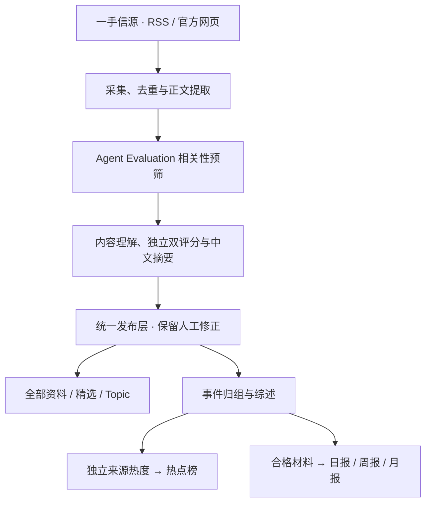

<p align="center">
  
</p>

<p align="center">
  <a href="LICENSE"></a>
  
  
  
  
  <a href="https://github.com/junli0324/agent-eval-radar/actions/workflows/check.yml?query=branch%3Afeat%2Fagent-eval-v0.1"></a>
</p>

<p align="center">
  <b>看懂 Agent 能力，先看评测证据。</b><br>
  为中文 AI 产品经理、评测人员和开发者，持续整理 Agent Evaluation 的方法、进展与边界。
</p>

<p align="center">
  <a href="#这是什么">项目介绍</a> ·
  <a href="#关注什么">内容范围</a> ·
  <a href="#本地跑起来">本地试用</a> ·
  <a href="#开启受限自动运行">自动运行</a> ·
  <a href="#文档导航">文档导航</a>
</p>

> **当前阶段：v0.1 本地试用与筛选校准。** 功能代码在 [`feat/agent-eval-v0.1`](https://github.com/junli0324/agent-eval-radar/tree/feat/agent-eval-v0.1)，请按下文切换分支。`main` 目前仅同步项目介绍，尚未合并 v0.1 功能；暂无公开在线演示站。

## 这是什么

AgentEval Radar 是一个面向 **Agent Evaluation** 的中文前沿情报站。它从一手信源收集资料，判断相关性与专业价值，生成中文标题和摘要，将相关报道归为事件，再整理成可检索的阅读库、热点榜与定期报告。

它关心几个具体问题：**Agent 到底能完成什么任务？怎样判断成功？分数在什么条件下成立？哪些失败值得复现和修复？**

这里的核心对象是 **Agent 的能力与行为评测**：编码、浏览器操作、Computer Use、工具调用、客服、研究、协作与长时程任务。Agent-as-a-Judge、LLM-as-Judge 也在范围内，前提是它们确实帮助评估 Agent。基础模型成绩、产品发布或融资新闻，需要有明确的 Agent 评测贡献才值得收录。

你可以用它选择 Benchmark、追踪评分协议变化、寻找评测工具，也可以沿着原文链接继续阅读。中文摘要保留 Benchmark、论文、模型和指标专名，例如 SWE-bench、OSWorld、τ-bench、Pass@k。

## 关注什么

### 六类内容

| 分类 | 重点看什么 | 典型问题 |
| --- | --- | --- |
| **评测基准** | Benchmark、任务集、环境与实质版本更新 | 测哪些真实任务？成功条件是什么？ |
| **评测方法** | 指标、评分器、轨迹分析、裁判校准与污染识别 | 分数可靠吗？怎么验证过程与结果？ |
| **论文研究** | 研究发现、综述、能力边界与失败分析 | 哪些结论改变了对 Agent 能力的判断？ |
| **工具框架** | Harness、沙箱、实验追踪、回归与红队工具 | 能否复用到自己的评测流程？ |
| **评测结果** | 任务成绩、独立复现、版本比较与成本分析 | 用了什么设置？成绩是否可比？ |
| **实践观点** | 评测落地、案例复盘、教程与方法论 | 有什么具体证据和可迁移做法？ |

### 十个 Agent 场景

| 任务场景 | 任务场景 |
| --- | --- |
| Code Agent | Browser Agent |
| Computer Use | Tool/API Agent |
| Research Agent | Customer Service Agent |
| Terminal Agent | Multi-Agent |
| Generalist Agent | Memory/Long-horizon |

能力标签贯穿各场景：任务理解、任务规划、工具选择、参数调用、执行轨迹、状态维护、记忆、异常恢复、结果验证、可靠性、鲁棒性、安全、成本与效率、人机协作、评测污染。**标签需要原文证据，提到某个词不会自动获得对应标签。**

## 精选与热门，各回答一个问题

| | 精选 | 热门 |
| --- | --- | --- |
| 回答的问题 | **值不值得认真读？** | **有多少独立来源正在关注？** |
| 主要依据 | 评测问题、方法增量、证据质量与可复用性 | 近期独立来源参与、时间衰减与事件归组 |
| 可以出现的情况 | 一篇传播很少的评分修复说明，也可能入选 | 一个传播广的事件，也可能缺少高质量评测证据 |
| 不会因为这些就成立 | 大厂发布、stars 多、宣称 SOTA、标题带 Agent | 重复抓取、单个来源反复发稿、历史资料补录 |

例如，τ-bench 的评分修复如果改变了旧成绩的可比性，可能很有专业价值；一条没有具体变更说明的版本标签，通常不足以进入精选。

当前沿用原有分级门槛 **T1 60 / T1_5 65 / T2 76**。后续以人工 gold set 校准筛选质量，不为填满页面调低门槛。

## 它是怎么工作的



筛选与写作标准放在 [`industry/prompts/`](https://github.com/junli0324/agent-eval-radar/tree/feat/agent-eval-v0.1/industry/prompts)，可以检查、修改并用样本验证。网页、RSS、公开 API 与 MCP 共用发布读取层；**读者打开页面不会触发模型调用**。

原文日期、版本和评测设置会保留。作者报告的成绩不视为独立复现，摘要不补写原文没有的结论。默认公开中文摘要与原文链接，全文展示需要相应授权。

## 你会得到什么

| 入口 | 用法 |
| --- | --- |
| **精选与全部资料** | 快速阅读中文摘要，按分类、标签和关键词找材料 |
| **Topic** | 沿着 Code Agent、Computer Use、Memory/Long-horizon 等场景持续追踪 |
| **事件与热点** | 合并同一事件的多来源报道，区分传播热度与专业价值 |
| **日报 / 周报 / 月报** | 在报告窗口结束后，将合格材料整理为带来源的阶段回顾 |
| **后台 `/admin`** | 管理信源、诊断处理步骤、查看回执与预算、修正公开内容 |
| **RSS / API / MCP** | 将公开内容接入阅读器、应用或自己的 Agent 工作流 |

仓库包含 **12 个初始信源配置**，另提供博客与[论文／实践入口安装脚本](https://github.com/junli0324/agent-eval-radar/blob/feat/agent-eval-v0.1/industry/v0.1/frontier-sources.md)；受限自动试运行白名单扩展为 **11 个入口**，仅使用已安装并启用的合格来源。信源配置、历史试用候选和你本地实际公开的文章，是三份不同的数据。**新克隆仓库不会带走维护者的数据库或已生成内容。**

页面顶部的[内容更新提示](https://github.com/junli0324/agent-eval-radar/blob/feat/agent-eval-v0.1/industry/v0.1/content-updates.md)会显示上次查看后有多少篇文章、多少份报告更新，点开可直接阅读。可见页面每分钟检查，查看记录仅存当前浏览器；查询不产生模型费用。

## 本地跑起来

先在自己的电脑试用，再决定服务器与域名。需要 **Git、Node.js 24.11+、Docker Desktop / Docker Compose**；Docker 方案会运行 PostgreSQL，无须另装本机数据库。

### 1. 获取 v0.1

以下命令可在 Windows PowerShell 执行，先进入你希望保存项目的目录：

```powershell
git clone --branch feat/agent-eval-v0.1 https://github.com/junli0324/agent-eval-radar.git
cd agent-eval-radar
node scripts/init-env.ts
```

初始化脚本生成本地 `.env`，并显示一次管理员密码；已有 `.env` 时会拒绝覆盖。请自己保存密码，不要分享包含密码的输出。

### 2. 先启动网站

用编辑器打开 `.env`，将下列开关设为 `false`。先确认网站可访问，再开启自动处理：

```dotenv
COLLECT_ENABLED=false
MODEL_CALLS_ENABLED=false
FEISHU_CONTENT_PUSH_ENABLED=false
FEISHU_INTERNAL_ENABLED=false
INDEXNOW_SUBMIT_ENABLED=false
```

```powershell
docker compose up -d --build db api web
docker compose ps
```

打开 **<http://localhost:3000>**；后台为 **<http://localhost:3000/admin>**，管理员密码见本地 `.env` 的 `ADMIN_PASSWORD`。此阶段没有模型费用，页面尚无文章是正常现象。

### 3. 选择内容入口

| 想先做什么 | 接着看哪份文档 | 是否产生模型费用 |
| --- | --- | --- |
| 先建立一个可浏览的资料库 | [试用资料库](https://github.com/junli0324/agent-eval-radar/blob/feat/agent-eval-v0.1/industry/v0.1/trial-library.md) → [分类覆盖补充](https://github.com/junli0324/agent-eval-radar/blob/feat/agent-eval-v0.1/industry/v0.1/coverage-trial.md) | 导入不调用模型；分析阶段会产生费用 |
| 先验证几条近期内容 | [近期内容试运行](https://github.com/junli0324/agent-eval-radar/blob/feat/agent-eval-v0.1/industry/v0.1/recent-trial.md) | 按步骤显式开启模型调用 |
| 已确认质量，希望自动更新 | [三天受限自动运行](https://github.com/junli0324/agent-eval-radar/blob/feat/agent-eval-v0.1/industry/v0.1/auto-trial.md) | 会，分析与报告等步骤共用请求预算 |

历史资料库用于阅读与校准；保留原始日期和补录标记，不会因为今天导入就变成今天的热点或日报。

## 开启受限自动运行

v0.1 提供 **72 小时的本地自动试运行**，复用已有的采集、分析、发布、归组、综述与报告流程。它不消费普通 worker 队列中积存的历史任务。

| 项目 | 当前配置 |
| --- | --- |
| 信源 | 原六源，加 arXiv 新论文公告、METR、Anthropic Engineering、Simon Willison 评测专题和 Hamel 评测实践；仅使用已安装并启用的合格来源 |
| 内容范围 | 最近 14 天、有原始日期、非历史补录的候选 |
| 模型 | 默认 `deepseek-flash`，非思考模式；准备脚本会核对模型路由 |
| 请求上限 | 最多 5 次/分钟、30 次/小时、100 次/滚动 24 小时；已有更低上限时保留 |
| 共享额度 | 分析、归组、事件综述、日报、周报、月报共同使用 |
| 到期行为 | 72 小时后停止启动新任务，在途操作完成后退出；重复启动不会延期 |
| 费用查询 | 查看本地回执、token 与模型提供商账单；未知费用不等于免费 |

**请求上限不是金额上限，一篇文章也可能需要多次模型请求。** 阅读网页不调用模型。实际费用受内容长度、缓存、生成量和提供商定价影响；先查看账单，再决定是否长期运行。

在本地 `.env` 填好 `LLM_API_KEY`、`LLM_BASE_URL`、`LLM_MODEL` 与非思考配置后，按 [完整启动说明](https://github.com/junli0324/agent-eval-radar/blob/feat/agent-eval-v0.1/industry/v0.1/auto-trial.md) 准备。受限 worker 必须使用两份 Compose 配置：

```powershell
docker compose stop worker
docker compose exec -T -e COLLECT_ENABLED=false -e MODEL_CALLS_ENABLED=false api node industry/v0.1/blog-sources.ts
docker compose exec -T -e COLLECT_ENABLED=false -e MODEL_CALLS_ENABLED=false api node industry/v0.1/frontier-sources.ts
docker compose exec -T -e COLLECT_ENABLED=false -e MODEL_CALLS_ENABLED=false api node industry/v0.1/auto-trial.ts prepare
docker compose -f docker-compose.yml -f industry/v0.1/compose.auto-trial.yml up -d --no-deps worker
```

检查运行状态与最近日志：

```powershell
docker compose exec -T -e COLLECT_ENABLED=false -e MODEL_CALLS_ENABLED=false api node industry/v0.1/auto-trial.ts status
docker compose logs --tail=30 worker
```

停止自动任务并恢复试运行前的预算：

```powershell
docker compose stop worker
docker compose exec -T -e COLLECT_ENABLED=false -e MODEL_CALLS_ENABLED=false api node industry/v0.1/auto-trial.ts stop
```

普通 `docker compose up worker` 会启动框架默认 worker；本试运行应使用上面的双配置命令。关闭终端不影响后台容器，**电脑关机、休眠或 Docker 退出会暂停处理，72 小时截止时间仍照常计算**。长期全天运行需要一台持续在线的设备。

<details>
<summary>重启电脑后，怎样继续本地试用？</summary>

打开 Docker Desktop，等待引擎就绪；使用代理联网时也要开启代理。在项目目录执行：

```powershell
docker compose up -d db api web
docker compose -f docker-compose.yml -f industry/v0.1/compose.auto-trial.yml up -d --no-deps worker
docker compose exec -T -e COLLECT_ENABLED=false -e MODEL_CALLS_ENABLED=false api node industry/v0.1/auto-trial.ts status
```

未到期的试运行会继续；到期则不会启动新任务。停机期间的资讯不保证全部补齐。普通停止或重启会保留数据卷；不要执行 `docker compose down -v`，它会删除本地数据库卷。

</details>

## 为什么有些页面可能暂时为空

| 页面 | 出现内容的条件 |
| --- | --- |
| **全部资料 / Topic / 精选** | 内容完成处理并满足各入口的发布条件；历史资料可用于阅读 |
| **热点榜** | 近期有足够的独立来源参与；单个官方发布即使入选精选，也可能没有热度 |
| **日报** | 报告窗口结束且有合格材料；北京时间每日 08:00 后检查 |
| **周报** | 有合格材料的已结束周；北京时间周一 10:00 后检查 |
| **月报** | 有合格材料的已结束月；北京时间每月 1 日 10:30 后检查 |

受限 worker 约每五分钟检查报告补缺，实际完成时间受运行状态、预算和处理耗时影响。没有合格材料时不出空刊，历史补录也不填入实时报告。三天试运行可能尚未经过周报或月报的出刊时间。

## 开发与校准

技术栈：**Node.js 24 · TypeScript · React Router · Fastify · PostgreSQL · pg-boss · Tailwind CSS · Docker Compose**。

行业定制主要位于 `industry/`，包名和内部技术命名保留上游命名空间，站点名称、雷达标识和报告品牌已独立。

| 位置 | 内容 |
| --- | --- |
| [`industry/site.ts`](https://github.com/junli0324/agent-eval-radar/blob/feat/agent-eval-v0.1/industry/site.ts) | 站点身份、首页与关于页文案 |
| [`taxonomy.ts`](https://github.com/junli0324/agent-eval-radar/blob/feat/agent-eval-v0.1/industry/taxonomy.ts)、[`topics.json`](https://github.com/junli0324/agent-eval-radar/blob/feat/agent-eval-v0.1/industry/topics.json) | 分类、场景与能力标签 |
| [`sources.json`](https://github.com/junli0324/agent-eval-radar/blob/feat/agent-eval-v0.1/industry/sources.json) | 初始信源；已有数据库配置通过相应升级脚本管理 |
| [`prompts/`](https://github.com/junli0324/agent-eval-radar/tree/feat/agent-eval-v0.1/industry/prompts) | 预筛、评分、理解、归组与报告标准 |
| [`v0.1/`](https://github.com/junli0324/agent-eval-radar/tree/feat/agent-eval-v0.1/industry/v0.1) | 本地资料库、校准记录与受限自动运行入口 |

CI 会执行类型检查、后端测试、Web 构建与测试、站点 smoke / MCP 检查，以及 Docker Compose 基础链路验证。测试关闭外部采集和真实模型调用；测试数据库必须以 `_test` 或 `_ci` 结尾。具体步骤见 [AGENTS.md](AGENTS.md) 与 [验证记录](https://github.com/junli0324/agent-eval-radar/blob/feat/agent-eval-v0.1/industry/v0.1/validation.md)。**工程检查通过，不代表筛选准确率已经得到验证。**

后续重点是建立独立人工 gold set：覆盖应入选、仅相关、应拦截和容易混淆的案例，分别检查预筛、精选、分类标签与摘要事实。将开发样本与最终评估集分开，先定位误筛原因，再调整提示词与门槛。当前试用目录不是独立测试集。

## 文档导航

以下功能文档均指向当前 v0.1 开发分支。

| 文档 | 用途 |
| --- | --- |
| [论文与实践信源扩充](https://github.com/junli0324/agent-eval-radar/blob/feat/agent-eval-v0.1/industry/v0.1/frontier-sources.md) | 已有试运行升级、来源取舍与停更诊断 |
| [站内内容更新提示](https://github.com/junli0324/agent-eval-radar/blob/feat/agent-eval-v0.1/industry/v0.1/content-updates.md) | 未查看数量、文章与报告直达、浏览器查看记录 |
| [三天受限自动运行](https://github.com/junli0324/agent-eval-radar/blob/feat/agent-eval-v0.1/industry/v0.1/auto-trial.md) | 启动、状态、停止、预算与运行边界 |
| [到期后的只读复盘](https://github.com/junli0324/agent-eval-radar/blob/feat/agent-eval-v0.1/industry/v0.1/trial-review.md) | 实际请求、未知费用、公开内容与报告诊断；不续期、不调用模型 |
| [试用资料库](https://github.com/junli0324/agent-eval-radar/blob/feat/agent-eval-v0.1/industry/v0.1/trial-library.md) / [分类覆盖补充](https://github.com/junli0324/agent-eval-radar/blob/feat/agent-eval-v0.1/industry/v0.1/coverage-trial.md) | 建立可浏览的历史资料库 |
| [近期内容试运行](https://github.com/junli0324/agent-eval-radar/blob/feat/agent-eval-v0.1/industry/v0.1/recent-trial.md) | 显式控制采集、提取、分析与发布 |
| [Topic 与阅读入口](https://github.com/junli0324/agent-eval-radar/blob/feat/agent-eval-v0.1/industry/v0.1/topics-reading-update.md) / [报告与资料回顾](https://github.com/junli0324/agent-eval-radar/blob/feat/agent-eval-v0.1/industry/v0.1/reports-reading-update.md) | 理解页面展示与历史补录 |
| [信源取舍](https://github.com/junli0324/agent-eval-radar/blob/feat/agent-eval-v0.1/industry/v0.1/sources.md) / [gold set 校准](https://github.com/junli0324/agent-eval-radar/blob/feat/agent-eval-v0.1/industry/v0.1/calibration.md) | 检查垂直筛选标准与评估计划 |
| [精选机制](https://github.com/junli0324/agent-eval-radar/blob/feat/agent-eval-v0.1/docs/selection.md) / [事件归组](https://github.com/junli0324/agent-eval-radar/blob/feat/agent-eval-v0.1/docs/grouping.md) | 理解评分、门槛与关系判定 |
| [部署](https://github.com/junli0324/agent-eval-radar/blob/feat/agent-eval-v0.1/docs/deploy.md) / [架构](https://github.com/junli0324/agent-eval-radar/blob/feat/agent-eval-v0.1/docs/architecture.md) | Docker、备份、域名、HTTPS 与内部结构 |

## 反馈与下一步

欢迎在 [Issues](https://github.com/junli0324/agent-eval-radar/issues) 提交信源建议、误筛样本、摘要错误和使用问题。附上原文链接、问题所在与期望判断，有助于复现和校准。不要附带 API Key、密码或完整 `.env`。

当前优先完善 **信源稳定性 → gold set 与筛选校准 → 自动报告质量 → 长期运行与部署**。v0.1 保持现有数据结构，暂不引入复杂 Benchmark Card。上线公开服务前，运营者还需确认使用规则、隐私说明、联系方式与内容权限。

## 来源与许可

本项目由 [AIHOT Template](https://github.com/KKKKhazix/AIHOT) 创建，感谢上游提供完整的网站框架与公开的筛选、归组和报告机制。本 README 的展示结构也参考了上游。

**AgentEval Radar 是独立项目，使用自己的名称与雷达标识。** 代码采用 [MIT License](LICENSE)，保留原作者版权声明；第三方内容、字体和标志的权利归属见 [NOTICE](NOTICE)。聚合摘要不改变原文版权，阅读与引用请以来源页面为准。

---

<sub><b>In English:</b> AgentEval Radar is a Chinese-first intelligence hub for evaluating AI agents: benchmarks, methods, research, tooling, results, and practice. It separates editorial value from attention, preserves source links and evaluation context, and provides a bounded local automation trial. The v0.1 implementation lives on the <code>feat/agent-eval-v0.1</code> branch.</sub>
