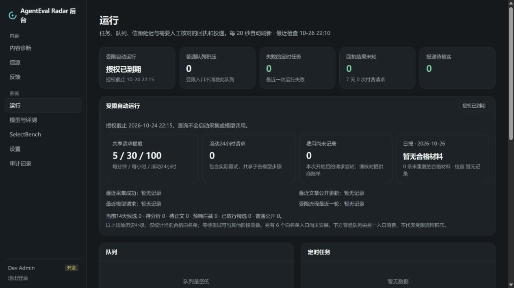

# 上线前第一批可靠性改进

本轮不增加信源，不调整评分门槛、不增加模型额度、不续期试运行，也不自动修订既有公开文章。无需数据库迁移。

## 完整摘要与只读回放

模型生成的摘要保留完整内容，仅整理换行和沿用身份校验。列表卡片继续通过现有 CSS 限制展示行数，详情页、报告候选和公开出口读取完整摘要；不会为了 190 字长度删除末尾的结果、负面发现或“不同指标不可比”等限制。提示词仍要求紧凑、答案前置和有原文证据，优先保留测量对象、结果及成立条件。

已有文章不会因升级被自动重写。先从保存的当前版本理解回执离线预览：

```powershell
docker compose exec -T -e COLLECT_ENABLED=false -e MODEL_CALLS_ENABLED=false api node industry/v0.1/summary-replay.ts --ids=ev0d28m3y56eiuunrcadobd1a,a1q0938ub0wmkztvtadbykdwf
```

该工具仅接受 1–20 个明确 ID，输出 before / after 和 changed，不保存分析或发布。没有受支持回执、版本过期或身份校验未通过时明确提示；人工标题、摘要或可见性修改保持原样。只处理当前理解回执，不把不支持的翻译回执猜成可恢复摘要。结果仅保存在本地 `.data/`，不提交原始模型回执。

## 共享额度下的任务顺序

受限 worker 每轮仍先检查到期与预算快照；免费采集之后，维护轮先补已结束的报告窗口，再处理至多 3 篇近期文章，最后至多 3 个待更新事件综述。没有合格材料时仍不出空刊，热点仍按原 48 小时独立来源规则计算。

遇到现有预算层的 `BudgetExceededError` 后，将建议恢复时间写入既有 last-tick 设置。退避期间不再启动模型处理、归组、报告或综述，免费采集与维护轮热点计算继续；进程重启也会读取该时间。到时间后只是重新检查，实际请求仍须经过原子预算保护；这不保证届时必有额度，也不为报告新增专用预算。

报告优先降低新文章挤占的风险，不承诺固定出刊数或时刻。每轮 3 篇是处理批量，不是每篇 3 次请求；分析仍保留两次独立评分。截止时间、共享 5/30/100 上限和历史队列边界保持不变。模型任务耗时期间每分钟继续上报心跳，避免把长任务误判为失联。

## 后台只读概览

以下为独立测试站的虚拟到期状态，不是用户数据库截图：



登录 `/admin/runs` 可查看受限入口状态、截止时间、额度下次检查、最近采集成功/文章公开更新/模型请求/受限轮次、未知费用数和当前 14 天候选管道。普通队列独立标注，受限入口不消费它。

- 正常运行、等待额度、授权到期、主动停止、异常离线、尚未开始分别展示。
- 当前预算与授权快照不一致时提示待核对；发现活跃普通 worker 时提示入口异常，不能用试运行到期推断普通 worker 已停止。
- 日报状态复用生产流程的候选、重复覆盖和空报告判断，展示已发布、暂无合格材料、等待共享额度、报告检查失败或等待处理。该状态只诊断最近已结束的日报窗口，周报/月报可继续通过原报告列表与复盘 CLI 检查。
- 查询不启动采集或模型，不新增启动/续期按钮。无试运行配置的部署继续展示原普通 worker 视图。接口保持管理员鉴权；前端只经 HTTP 获取数据。

## 升级与验收

按[更新栏升级步骤](content-updates.md)只更新 API/Web 镜像，保持已到期 worker 停止。新调度必须在未来另行批准的运行窗口中启用，本轮测试不恢复自动采集。

验收重点：完整摘要与末句限制保留；报告先于新文章；退避期间无付费尝试；到期与异常离线区分；普通队列不冒充受限积压；只读查询与回放不改数据或费用。工程测试通过不替代独立人工 gold set，也不代表已经完成长期运行或备份恢复验收。

2026-10-26：typecheck、Web build、20 项 Web 测试及独立 Linux/PostgreSQL 下的 223 项后端测试通过。Docker 镜像构建、四服务启动、种子数、整站 smoke/MCP 通过；浏览器确认到期状态、预算、日报诊断与普通队列分开展示。两篇现有文章只读预览分别由 99→265 字、86→207 字，0 模型调用、0 写入；未发布该修订。远端 CI 以 PR 当前 head 的检查结果为准。
